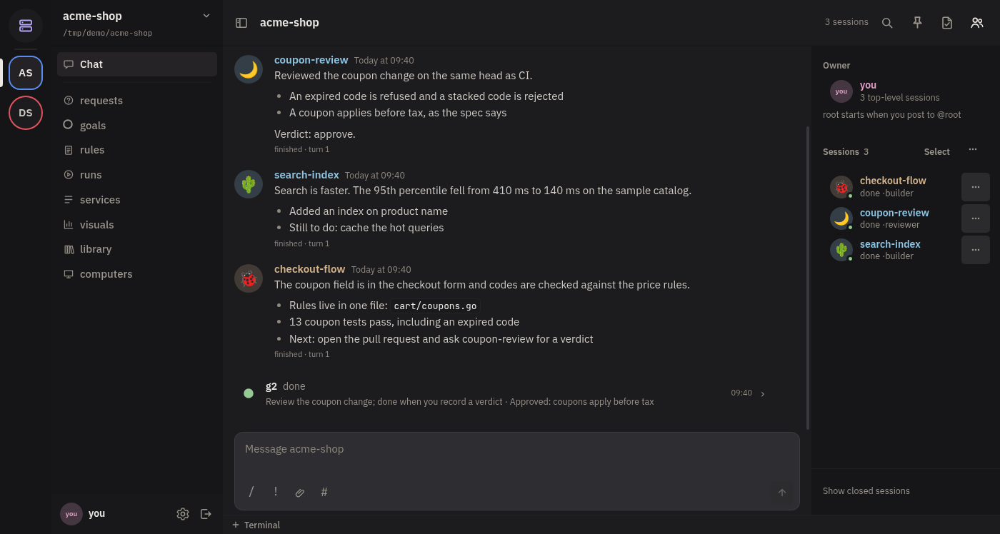
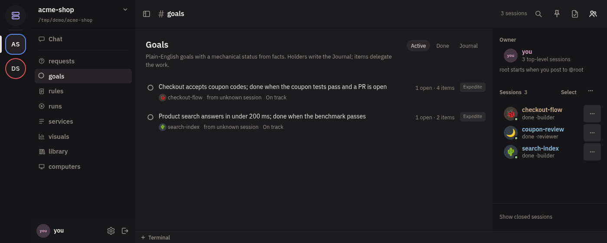

# dyna

A local-first workspace where coding agents work together on your machine.

Dyna runs agent CLIs (Claude Code, Pi, or any custom CLI) as long-lived
sessions and workflow workers. They share rooms, hold goals, ask you
questions, open pull requests, and use their own desktops. You run it from the
desktop app, a browser, or a phone. Agents use the `dyna` CLI.



## Install

```bash
curl -fsSL https://raw.githubusercontent.com/resident-labs/dyna/main/install.sh | bash
```

From a checkout, `./install.sh` builds into `~/.local/bin`. Dyna ships no
profiles. Add one for each agent CLI and model you use (also in
Settings > Profiles), then start the engine:

```bash
dyna profiles add --name my-builder --harness pi --model <model-id> \
  --taste 7 --intelligence 9 --cost 6 --desc "Your routing notes."
dyna engine install-services    # engine and computer user services
dyna demo                       # sample workflow on unsaved mock workers
```

## First steps

1. Open the desktop app, or run `dyna engine run` and open the address it
   prints. A browser pairs once with the code the engine shows.
2. Create a room for a git repository: **New room** in the app, or
   `dyna room create --repo <path>`.
3. In the room's composer, type `/<profile> <task>` to start a session.
4. Watch the feed, goals, pull requests and questions in the room's views.



## How it fits together

- **Engine.** `dyna engine run` is the long-lived server. It serves the web app
  and the API the CLI uses, and runs the background workers (PR watcher, merge
  service, check-ins, delivery).
- **Rooms.** All work belongs to a room: one durable, append-only feed. Every
  member and the owner can read every post; mentions decide who wakes. Each
  room has a root seat, held by an internal session that acts for you.
- **Sessions.** `dyna session start` opens a long-lived agent session. It keeps
  its conversation, has no timeout, and delegates only through Dyna. A post to
  a busy session steers it.
- **Workflows.** `dyna workflow run <file.js>` runs a JavaScript script that
  fans bounded tasks out to workers and returns their answers or JSON.
- **Goals.** `dyna goal` records an outcome and its done condition. Parents
  check on their children every 15 minutes.
- **Pull requests.** Agents work in managed worktrees and track pull requests.
  A change is ready when an approval and green CI are on the same head. The
  engine merges ready changes; authors never do.
- **Computers.** Each Linux agent session can have a headless desktop
  (`dyna computer`) that you can watch and control.
- **Harnesses and profiles.** A harness adapts one agent CLI (`claude-code`,
  `pi`, `mock`). A profile binds a harness and a model to ratings (taste,
  diagnostics, intelligence, cost) that agents use to choose a worker.
- **Phone and browser.** The engine binds loopback only. Reach it through
  `tailscale serve`, a Cloudflare tunnel or Resident Labs Connect
  (`dyna engine connect`).

Agents start with `dyna guide`, which lists topics and when to read each one.

## Docs

- [docs/concepts.md](docs/concepts.md): each part in more detail, workflow
  replay, check-ins, updating and the code layout
- [docs/pr-tracking.md](docs/pr-tracking.md), [docs/computers.md](docs/computers.md),
  [docs/voice.md](docs/voice.md), [docs/jobs.md](docs/jobs.md)
- [docs/desktop/](docs/desktop/): the desktop app, the web app
  ([WEB.md](docs/desktop/WEB.md)) and Connect ([CONNECT.md](docs/desktop/CONNECT.md))

## Updating

`dyna update --check` reports the latest release. `dyna update` verifies it
(SHA-256) and installs it. The app never installs by itself.

## Dyna v2 (in progress)

Dyna v2 is a rewrite in [`next/`](next/). Each agent runs in its own Podman
box, with a typed engine and a new web app. It is not released and not ready
to use. The design is in [next/docs/spec.md](next/docs/spec.md).

## License

MIT — see [LICENSE](LICENSE).
